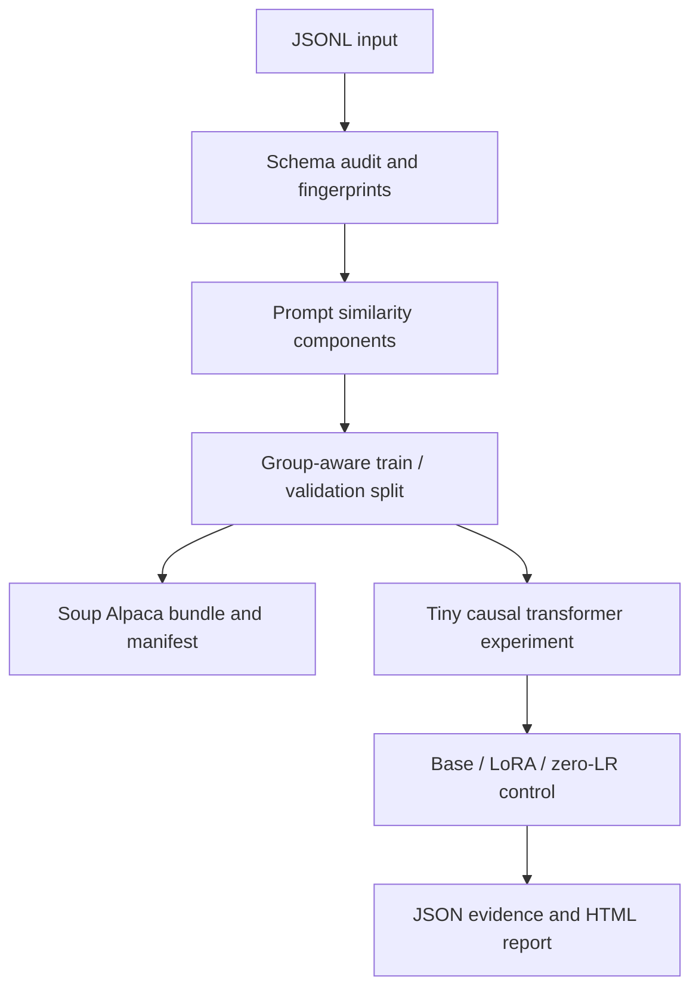

# TuneProof architecture

Status: design recorded before implementation.

## Problem and scope

A lower training loss does not prove that fine-tuning improved a model. Duplicate
prompts can leak across splits; a broken optimizer can produce plausible logs.
TuneProof makes those failure modes inspectable in a small CPU-reproducible lab.

This is an independent educational companion to Soup, not an upstream feature,
production LLM, or a claim of measured performance on a billion-parameter model.

## Data flow

## Components and contracts

| Module | Responsibility | Invariant |
| --- | --- | --- |
| `data.py` | Strict JSONL parsing, Alpaca / single-turn ChatML normalization, Unicode-normalized prompt fingerprints, near-duplicate grouping, deterministic split | No prompt component crosses the split; invalid rows are reported, never silently repaired |
| `bundle.py` | Write train/validation JSONL, Soup YAML and hash manifest into a fresh directory | Input is never overwritten; output directory must not exist |
| `model.py` | Byte-token causal transformer, response-only loss, explicit LoRA projection | Frozen base weights remain unchanged during adaptation; padding/prompt tokens do not contribute to response loss |
| `experiment.py` | Deterministic CPU pretraining, adapter training, zero-learning-rate control, held-out evaluation and checkpoints | Same initial checkpoint and batches for adaptation/control; evaluation never trains |
| `report.py` | Escape untrusted strings; generate self-contained HTML from measured artifacts | No CDN, network, invented metrics or unescaped dataset text |
| `cli.py` | `audit`, `prepare`, `experiment`, `verify` commands | Invalid input returns nonzero; partial artifacts are not presented as successful runs |

## Experiment design

1. Generate a documented synthetic text-routing task with separate train and
   held-out prompts. Labels are not included in the prompt. No external model,
   credentials, paid API or GPU is needed.
2. Pretrain a tiny causal transformer on training prompts and verbose answers.
3. Freeze the base; fit LoRA matrices on a different, compact answer format.
4. Compare base vs adapted model using response-token negative log likelihood
   and greedy exact-match label accuracy on held-out examples. Report both.
5. Repeat the adapter loop at LR=0 with identical batches. The control must have
   identical parameters/logits to the base. Check frozen parameter hashes too.
6. Save configuration, seed, environment, input hashes, steps, timings, metrics,
   curves and checkpoints. A verifier recomputes artifact hashes.

The task is deliberately small. Reduced loss does not imply broad reasoning,
instruction-following, or real-world language ability. Single-seed results are
not statistical significance. Tokenization uses UTF-8 bytes, not word counts.

## Leakage algorithm and limits

Compare canonical user prompts (not answers). Exact prompt matches, including
conflicting answers, belong to the same component. Near-duplicate edges use
Jaccard similarity of Unicode word bigrams; union-find makes grouping transitive.
Seeded component shuffling builds a nonempty held-out split. Conflicting exact
prompt labels are blocked at preparation. Near-duplicate detection is lexical,
not semantic. Pairwise comparison is O(n²), so reject inputs above 2,000 rows
and 10 MiB. This explicit cap keeps the lab predictable.

## Output and failure policy

Build complete output in a sibling staging directory and rename it only after
all files are written. Refuse an existing destination. Artifact SHA-256 values
bind the files in the manifest; this detects accidental changes, not hostile
rewriting of both files and manifest. No pickle checkpoint loads from strangers.
PyTorch loads use `weights_only=True`.

## Verification plan

- Unit: invalid JSON/types, both supported formats, empty text, Unicode
  equivalence, duplicate/conflict grouping, transitive near duplicates,
  reproducible splits, impossible splits, parameter validation.
- ML: causal attention (future tokens cannot change past logits), prompt/padding
  mask, initial LoRA identity, frozen base, nonzero gradients and zero-LR control.
- Integration: complete CLI flow, Soup bundle shape, hashes/tamper detection,
  safe HTML escaping, output collision and failure cleanup.
- Regression: real small CPU experiment plus checked-in measured evidence;
  CI runs lint, unit/integration tests and experiment smoke on Python 3.11/3.12.

## Deliberate tradeoffs

No authentication, remote execution, automatic GPU rentals, hidden LLM judge,
or training simulation. HTML is a local experiment report. Soup export is a
configuration/data handoff; the tiny custom model is not a Soup/PEFT checkpoint.
Large-model Soup execution is a separately documented optional validation step.
